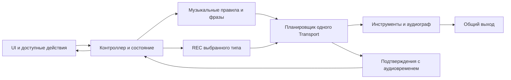

# Pinkbox — архитектура

Статус: архитектура уточнена по итогам T-01. Пользователь подтвердил событийный REC, генерацию по музыкальным правилам и scope BPM/VOL/FILTER; оставшиеся детали приняты по делегированию в SPEC §2.2. Бюджеты приняты в SPEC §2.3. Описанный событийный MVP реализован; результаты технических проверок и оставшаяся авторская приёмка находятся в PLAN.

Пользователь разрешил IMPLEMENTATION, а затем выполнение всех 17 задач в одном проходе. Указания SPEC о предыдущем этапе без архитектуры описывают исторический статус; они не запрещают текущую работу. Остальные ограничения и статусы требований сохраняются. SPEC не изменяется этим документом.

## 1. Граница решения

Цель — непрерывное выступление внутри одного музыкального мира, автоматическое исполнение, сохранение фразы через REC и управляемые наложения. Источник истины по функциям — SPEC, а последовательность работ — `docs/PLAN.md`.

Архитектура включает генерацию нотных фраз четырёх ролей, событийный REC, BPM, VOL и FILTER выбранной партии. Сцены, автоматический сценарий всей композиции, ручная клавиатура, DRUMS, экспорт, проекты, MIDI-вход и серверное хранение не добавляются. PITCH, KEY, SCALE, остальные эффекты и визуализатор отложены.

Исходная версия сохранена в legacy-pinkbox. Текущий main использует прежний Bun/Tone build, а WAV-проигрывание заменено событийным синтезом согласно SPEC. Сохраняемые части нужно проверять на соответствие новой семантике; сам факт наличия функции в текущем интерфейсе не утверждает её для новой версии.

## 2. Техническая основа

| Решение | Предложение и обоснование | Статус |
| --- | --- | --- |
| Runtime, установка, сборка | Сохранить Bun и существующий локальный сервер; не добавлять backend ради исполнения музыки. | Техническая рекомендация; текущая база проекта |
| Язык и UI | JavaScript ES modules, DOM и CSS; без обязательного React, Redux или нового framework. | Техническая рекомендация для простоты |
| Работа со звуком | Tone.js поверх Web Audio; один AudioContext и один Transport. | Техническая рекомендация по исходному ориентиру SPEC |
| Версия Tone | Исходная установленная версия — 15.1.22. Пользоваться публичным API, проверенным для этой версии; обновление не требуется автоматически. | Подтверждено package.json, не решение об обновлении |
| Данные и логика | Обычные объекты состояния и чистые функции; объекты Tone, буферы и DOM-ссылки хранятся отдельно. | Техническая рекомендация |
| Запись | Ноты/ритм выбранной партии за 4 такта; один слот и безопасная замена; тембр изменяем. | Решения T-01 приняты; проверка T-03/T-09 |
| Инструменты | Tone.PolySynth для KEYS, Tone.Synth для BASS/SYNTH/ARP; реальные синтезированные звуки, без подмены функций WAV-заглушками. | Технический выбор по делегированию; настройка/прослушивание T-04 |
| Тесты | Чистую логику проверять Bun test; реальное аудио и UI — браузерными проверками и прослушиванием. | Предложение, не уже установленная инфраструктура |

Bun работает на стороне разработки. Аудио воспроизводится браузером, не сервером Bun. Изменение server.js допустимо позднее только при выявленной необходимости; сборочный workaround для Tone не убирать без проверки браузерного bundle.

### 2.1. Реализованные модули и конкретные параметры

- `patterns.js`: ограниченный генератор и валидация событий, PPQ 192, шаг 48 ticks, 4 такта = 3072 ticks. ARP поддерживает непрерывную восьмую пульсацию, варьируя ноты и акценты. Все вариации используют общую статичную Cm7-основу; различаются voicing, ритм и мелодия, поэтому записи с разным начальным тактом совместимы.
- `state.js`: чистый PerformanceState; намерения, следующая доступная граница, статус запуска, REC-транзакция и по одному slot на роль. Проверяется Bun test без аудио/DOM.
- `audio.js`: один Transport scheduleRepeat 1/16; атаки и note-off исполняются с callback time. На шаге сначала releases, затем attacks. Принадлежность сессии и generation блокируют поздние callbacks.
- Граф: PolySynth (KEYS, максимум 8 голосов) / три Synth → свой lowpass → gate сессии → master Gain → Destination. FILTER отображается логарифмически от 180 до 18000 Hz; VOL 80% исходно, технический коэффициент выхода 0.8 даёт запас.
- Lookahead 60 ms, updateInterval 20 ms. Следующая доступная граница вычисляется после последнего уже запланированного шага, а не по времени клика. Точность/нагрузка проверяются в Chromium; это не обещание аппаратной задержки.
- STOP снимает единственное расписание, останавливает Transport, отменяет Draw, закрывает gate за 12 ms. Старый gate никогда не открывается вновь; через 160 ms сессия освобождается. Context timeout используется только для освобождения ресурсов, не для нот.
- Первый REC захватывает текущее live-исполнение без принудительной смены фразы в начале записи; естественная генерация на границе live-цикла продолжается. Повторный REC saved слоя переключает его на свежий кандидат. REC публикует кандидат после проверки на конце 4 тактов, в audible Draw-confirmation. До публикации старый slot сохранён; кандидат временно повторяется тем же источником, без второго инструмента.
- `ui.js` обновляет существующие элементы без перестройки DOM; BPM во время редактирования не перезаписывается clock-индикацией. `main.js` соединяет controller/UI и безопасную остановку при visibility/pagehide.
- `build.js` сохраняет исходный Tone browser bundle workaround; `server.js` использует его, build-script создаёт статичный dist. Встроенный синтез не загружает старые WAV.
- В продукте analyser/AudioWorklet не создаются. Browser-тесты отдельно подключают измеритель/PCM capture для проверки и аудиодемонстрации; это не альтернативная реализация пользовательского REC.

## 3. Наблюдения по существующему проекту

Инспекция исходников выявила следующие ограничения; новые функциональные испытания приложения на этом этапе не проводились:

- `audio.js` создаёт Player для WAV и перезапускает активные файлы каждый такт. Это не реализация REC.
- Playback rate объединяет изменение BPM и транспонирование. Для звучащего файла это меняет и длительность, и высоту; повторный старт на границе такта может обрезать или повторить материал.
- SCALE реализован фиксированным сдвигом всей записи. Это не преобразование нот в другой лад.
- STOP останавливает только Player, который уже имеет состояние started. Для новой архитектуры этого недостаточно: нужно учитывать события и источники, уже запланированные в будущем.
- PAUSE останавливает Player; возобновление Transport само по себе не восстанавливает середину остановленного файла. В новой версии PAUSE отложена.
- Состояние распределено между переменными аудио и UI. Для REC понадобятся явные состояния записи, ожидающих действий и сохранённой основы.
- `setTimeout` в main.js выключает визуальный LED. Визуальный таймер сам по себе допустим, но не может управлять звучанием.

Эти наблюдения задают объём проверки и локальной переработки, а не разрешение на необоснованное переписывание всего проекта.

## 4. Логические границы приложения

Это логические ответственности, а не обязательный отдельный файл или класс для каждого блока. Начать с существующих main.js, patterns.js, audio.js, ui.js и style.css. Простое состояние можно выделить в state.js, запись — в recording.js, только если это облегчает независимое тестирование. Не создавать generic plugin system или универсальные адаптеры заранее.

### 4.1. Состояние приложения

Один контроллер принимает намерения пользователя, проверяет допустимость и обновляет состояние. UI не вызывает отдельные инструменты напрямую.

Предлагаемые группы данных:

| Группа | Содержание |
| --- | --- |
| Готовность | idle/loading/ready/error, состояние AudioContext, доступность выбранного материала |
| Исполнение | stopped/starting/running/stopping; paused только при включении паузы; номер поколения исполнения |
| Музыкальный мир | Идентификатор согласованного набора, его гармонические ограничения, текущие разрешённые параметры |
| Партии | Стабильный id и роль; выбранная фраза; желаемая и фактическая активность; ожидающее действие и его музыкальная граница |
| REC | idle/armed/recording/finalizing/error и сведения о сохранённой фразе; часть состояний применяется только к выбранному способу записи |
| Сохранённая фраза | Идентификатор, принадлежность выбранной партии, длительность и версия сохранённых нот/ритма |
| Выход | Общая громкость VOL и независимые значения FILTER четырёх ролей |

Это техническая модель, не новый перечень кнопок. На каждую партию хранится одна фраза; новый кандидат заменяет её только после успешной записи. Хранение относится к текущей сессии; переживание перезагрузки не обещается.

Состояние хранит намерение и подтверждённый результат отдельно. Клик может сразу показать ожидание, но не состояние «звучит» до соответствующего аудиовремени. Наличие данных записи отличается от текущего состояния REC и от факта её воспроизведения.

AudioContext, инструменты, AudioBuffer, идентификаторы расписания, pending voices и callback-ссылки принадлежат аудиосессии. Они не копируются при каждом UI-действии и не сериализуются вместе с обычным состоянием.

### 4.2. Музыкальная логика

Описания мира содержат C minor, 4/4, сетку 1/16, диапазоны ролей и правила генерации 4-тактовых нотных фраз. Сохранённые события имеют позицию в ticks, ноты, длительность и velocity. PCM-запись и целые WAV-лупы не являются форматом нового REC.

Чистые функции отвечают за ограничения, вычисление границ, длину цикла и допустимые преобразования. Они не читают DOM и не обращаются к часам компьютера.

Начальный мир должен быть прослушан и принят автором. При наличии нотного материала допустимость нот и диапазонов можно проверять автоматически, однако это не доказывает музыкальную выразительность. Для WAV без нотных метаданных автоматическая проверка лада не обещается.

Назначения KEYS/SYNTH/BASS/ARP заданы SPEC §2.2. Генератор использует ограниченные правила и управляемый seed, чтобы технические тесты были воспроизводимы. Это не отдельный пользовательский регулятор. Незаписанный слой получает фразу на границе своего 4-тактового цикла; записанный слой повторяет сохранённые события без повторной генерации.

При повторном REC на выбранной границе генератор создаёт live-кандидат вместо старого playback этой партии. Данные старой записи остаются до успешной атомарной замены. Источник не удваивается. Выключение цели отменяет кандидата; выбор другой роли сам по себе не переназначает запись. REC во время armed/recording не создаёт вторую транзакцию.

## 5. Музыкальное время и синхронизация

### 5.1. Единственные часы

Все партии используют один Tone Transport. Позиции и длины событий выражаются в целых ticks. PPQ задаётся один раз до создания событий. Размер 4/4, базовая сетка 1/16, REC имеет длину 4 такта. Включение/выключение партий и BPM применяются на ближайшем доступном начале такта; STOP немедленный.

Web Audio time используется для точного исполнения. Tick-позиция задаёт место события в музыке, а аргумент `time` callback Transport — момент его исполнения в AudioContext. Нельзя подставлять вместо него Date.now, время клика или независимо рассчитанный таймер.

Ноты или источники запускаются с переданным аудиовременем. Обычные JS timers и requestAnimationFrame не создают музыкальный clock. JS-планировщик Tone заранее передаёт события Web Audio; браузер исполняет уже запланированное аудио независимо от точного момента UI-отрисовки.

Lookahead не устраняет последствия неограниченной нагрузки или приостановки браузером. Его величина и частота работы контекста измеряются на выбранных устройствах; их нельзя объявлять гарантией точности или обнулять ради кажущейся мгновенной реакции.

### 5.2. Вступление, выключение и границы

Контроллер вычисляет ближайшее доступное начало такта из общей tick-позиции с учётом уже запланированного аудио. Если граница уже прошла с точки зрения lookahead, выбирается следующая, а не событие задним числом.

Начало, выключение или замена фиксируются как pending command с id партии, поколением, версией фразы и целевой tick-позицией. Повторное переключение активности до границы отменяет ожидающее действие; оно не создаёт несколько независимых стартов. Пока Transport остановлен, переключается выбор партий для следующего PLAY.

Не смешивать callback AudioContext time и Transport ticks. `nextSubdivision` возвращает аудиовремя, имеет ограничения при темповых ramp и при неработающем Transport; его нельзя использовать как универсальное вычисление tick-позиции.

### 5.3. Повторение фразы

Для нотной фразы события сохраняются относительно её начала. Повторение строится через Tone.Part/Sequence либо зарегистрированные события Transport; длина фразы задаёт loopEnd. Все голоса одного события получают одинаковый `time`.

Новые роли исполняют генерируемые нотные события через выбранные Tone-инструменты. Старый periodic restart целого WAV не заменяет событийный REC; WAV-заглушки не используются как подмена нового генератора.

Сохранённая фраза имеет длину 4 такта. Захватываются события с атакой внутри интервала; длительность ограничивается концом цикла согласно SPEC §2.2. На общей границе note-off предыдущего события не должен погасить новую атаку того же инструмента; порядок и владение голосами проверяются T-03/T-09. Одновременный live-источник и его копия не включаются.

### 5.4. Изменение BPM; фиксированная гармония

BPM включён: исходно 120, диапазон 60–160, шаг 1. Изменение планируется на ближайшем доступном начале такта. Нотные позиции остаются в ticks. Будущие события следуют Transport; уже запланированные атаки и длительности требуют проверки. Note-off также планируется в музыкальном времени, а не один раз вычисляется в секундах на всю фразу. При смене BPM REC сохраняет длину 4 такта, а не фиксированное число секунд.

Для выбранного событийного REC time-stretch аудиозаписи не требуется. Изменение старого WAV через playbackRate меняет темп и высоту вместе и не считается реализацией независимых BPM/PITCH новой версии. Их включение и поведение событий по-прежнему определяются Q-06.

KEY/SCALE/PITCH отсутствуют в MVP; исходная гармония фиксирована. Их наличие в старом коде не даёт оснований оставить действующие controls в новом UI. Изменение темпа не меняет ноты или их высоту.

Плавный темповой ramp, swing и транспонирование не считаются обязательными.

## 6. REC: согласованная событийная запись по партиям

### 6.1. Сохранение музыкальных событий

REC захватывает фактически выбранные музыкальные события за согласованный интервал в ticks: начало, длительность, ноты/ссылку на источник, velocity и необходимые параметры. Сохраняется получившаяся фраза, не неопределённое состояние будущей генерации.

Преимущество: точное повторение музыкального содержания, небольшие данные и удобное управление темпом. Ограничение: повторное исполнение через инструмент не гарантирует побитового совпадения звука; live-эффекты, случайные параметры синтеза и политика сохранения тембра требуют решения Q-02.

**Подтверждено пользователем:** REC сохраняет ноты и ритм выбранной партии, слои независимы, тембр можно менять после записи. Запись начинается на ближайшем доступном начале такта, длится 4 такта и автоматически переходит к повторению (D-10–D-12 в SPEC). Изменение тембра не переписывает сохранённые ноты/ритм; автоматизация параметров отложена по делегированию.

### 6.2. Граница выбранного решения

PCM-захват, MediaRecorder/Tone.Recorder, AudioWorklet для записи и time-stretch записанного микса не реализуются в текущем scope. REC сохраняет события, один слот на роль; тембр/эффекты остаются live-параметрами без автоматизации. Технические пределы числа событий определяются T-02/T-03. Новый способ аудиозаписи потребует изменения scope.

### 6.3. Общая транзакция записи

1. Проверить готовность и допустимость REC.
2. Зафиксировать выбранную партию, поколение и ближайшую доступную границу начала такта. Определить конец через 4 такта в музыкальных ticks; не вычислять длину один раз из предполагаемого BPM в миллисекундах.
3. Начать захват на этой границе; отобразить recording в соответствующее аудиовремя.
4. Завершить после 4 тактов и подготовить кандидат фразы с относительными музыкальными позициями событий.
5. Проверить длину, целостность и принадлежность текущему поколению; опубликовать сохранённую фразу атомарно.
6. Автоматически включить повторение после конца записи, не прерывая другие партии и не удваивая live-источник выбранной партии.

Ошибочный/прерванный кандидат не отображается как успешная запись. Прежняя сохранённая фраза не изменяется до атомарной публикации успешного кандидата. STOP прерывает незавершённый REC и сохраняет готовые фразы. Позднее завершение операции после STOP или смены сессии не может самостоятельно запустить звук. Эта защита не добавляет историю undo или несколько clips на партию.

## 7. Аудиограф, преобразования и остановка

### 7.1. Аудиограф

Граф каждой роли: инструмент → Tone.Filter low-pass → gain роли. Четыре ветки смешиваются → gate сессии → общий VOL → destination. Значение FILTER хранится отдельно для каждой роли, UI изменяет выбранную; VOL влияет на весь микс. REC получает музыкальные события до исполнения; точки захвата аудиомикса нет.

Инструменты создаются при подготовке аудиосессии, переиспользуются во время исполнения и освобождаются при её завершении/замене. Клик pad или шаг фразы не создаёт новый Synth, общий эффект или AudioContext. Короткоживущие source nodes для воспроизведения буфера допустимы, но имеют владельца и ограниченный жизненный цикл.

### 7.2. Эффекты и выразительные преобразования

Минимальный набор утверждён: FILTER выбранной роли, BPM, VOL и активность партий. FILTER является Tone.Filter low-pass с UI 0–100%; 100% — открытый фильтр. Частотное отображение и начальный звук проверяются в T-04/T-11. REVERB/DELAY/SWING не создаются.

Один FILTER на роль, не новый экземпляр на каждое движение регулятора. Gain/cutoff изменяются со сглаживанием в аудиовремени; величина сглаживания проверяется на слышимость и отзывчивость. VOL исходно 80%, диапазон 0–100%; ноль даёт тишину без остановки музыкального времени.

Изменения музыкального рисунка применяются по музыкальной границе; FILTER/VOL — live-параметры со сглаживанием. Не перепутать преобразование одной партии с изменением другой. FILTER остаётся в аудиографе, не запекается в REC и не записывается как автоматизация. Остальные эффекты отложены.

### 7.3. Корректный STOP

STOP Transport сам по себе не гарантирует тишину: неподчинённые Transport источники, envelopes, события внутри lookahead и хвосты эффектов могут продолжать звучать. Предлагаемый технический протокол:

1. Контроллер блокирует новые старты и помечает сессию как останавливаемую. Новые асинхронные результаты не могут запустить её заново.
2. Определяется единый ближайший момент остановки в AudioContext с учётом технически необходимого короткого fade. Пользователь выбрал немедленный STOP; ожидание следующего такта не применяется. Измеримый допуск реакции определяет T-02.
3. Планировщик запрещает новые события и очищает принадлежащие сессии event IDs; Part/Sequence отменяются и освобождаются по их публичному API. Поколение инвалидирует устаревшие callback. После завершения список расписания пуст или содержит только явно сохраняемый инфраструктурный callback.
4. Все активные и уже запланированные голоса/источники прекращаются или изолируются в этот же аудиомомент. `player.state === started`, один `releaseAll` или проверка поколения недостаточны для уже переданных Web Audio будущих атак.
5. На выходе останавливаемой сессии выполняется короткое плавное закрытие gain после эффектов. STOP должен прекращать звучание, поэтому хвосты не продолжают играть после согласованного допуска. Длительность fade измеряется и согласуется в T-02, не превращаясь в музыкально отложенный STOP.
6. Для используемых источников проверяется публичная отмена будущих событий. Если она не обеспечивает безопасность, ветка старой сессии остаётся закрытой и освобождается; новая сессия не открывает gate старой ветки. Это предотвращает отложенные «призрачные» атаки.
7. Незавершённый REC прерывается, кандидат отбрасывается, готовые фразы сохраняются. Поздняя finalization проверяет поколение. Transport останавливается; следующий PLAY запускает выбранные партии с нулевой позиции общего цикла.
8. UI получает подтверждение остановки в правильное аудиовремя. Повторный STOP безопасен; следующий START не удваивает инструменты или расписание.

Очистка по `cancel` не заменяет отдельный реестр владельцев событий и источников. Конкретную стратегию отмены для выбранного Synth/Sampler/Player нужно доказать в браузере, особенно при STOP прямо перед будущей атакой.

Освобождение памяти после audio fade можно делать обычным механизмом обслуживания; это не clock для музыки. Резко dispose звучащего графа без предотвращения щелчка нельзя считать корректной остановкой.

PAUSE/RESET пока не включены. Их нельзя молча добавить или реализовать переименованием согласованного STOP. Сохранённые фразы и выбор партий переживают STOP; следующий PLAY не возобновляет прежнюю середину цикла.

## 8. UI, индикация и визуализатор

UI выводит состояние и отправляет команды. Данные с аудиовременем синхронизируются через Tone.Draw либо эквивалентное аудиопривязанное обновление; callback запуска музыки не перерисовывает весь DOM.

Для регуляторов сначала использовать семантические button/input range с доступными именами, клавиатурой и фокусом. Hardware-стиль создаётся CSS. Если позже будет выбран drag-knob, клавиатурный способ и читаемое значение сохраняются. Точные controls и layout зависят от Q-15/Q-18.

Ожидание, активность и запись различаются не только цветом. Не озвучивать каждый beat через screen reader. Обновлять только изменённые значения; индикатор музыкального шага не должен сбрасывать фокус или slider drag.

Основной размер доступной области браузера и стандарт контраста согласуются до финальной компоновки. Минимальные размеры/мобильные компромиссы не выбираются автоматически уменьшением всех кнопок.

**Визуализатор отложен по решению пользователя.** Архитектурный вариант на будущее: один Tone.Analyser/метр получает копию сигнала; requestAnimationFrame только читает данные и рисует, не управляя музыкой. В MVP analyser, FFT и отдельный display не создаются. Музыкальные индикаторы остаются частью состояния UI.

## 9. Загрузка, ошибки и совместимость

Предзагрузить только необходимые согласованные материалы, не все потенциальные будущие банки. Загрузка может начаться без звука; создание/разблокировка контекста не означает автоматическое воспроизведение. Tone.start вызывается непосредственно из допустимого пользовательского действия; проверка готовности не должна маскировать браузерный отказ или показывать running раньше успешного запуска.

Подготовка идемпотентна: параллельные клики запуска разделяют одну операцию и не создают несколько контекстов или слушателей. Ошибки материала, запуска и REC имеют отдельные состояния. Политика частичной готовности и retry определяется Q-14/Q-16; успешное сохранение не показывается при ошибке.

После background/suspension контроллер сверяет реальное состояние AudioContext и Transport. Не обещать непрерывность звука при системной блокировке. Политика возврата, ошибки либо возобновления согласуется для выбранных браузеров; нет автоматического «догоняющего» шквала событий.

На окончательной приёмке проверяются реальный browser audio, keyboard, доступная область viewport и длительное выступление. Headless-успех не доказывает слышимость и отсутствие щелчков на пользовательском устройстве.

## 10. Риски и способы проверки

| Риск | Последствие | Мера и проверка в PLAN |
| --- | --- | --- |
| Жизненный цикл REC не определён полностью | Потеря фразы при ошибке или повторной записи | T-01, T-03: уточнить Q-04 и проверить короткий полный цикл |
| Материал несовместим | Технически корректный, но музыкально слабый продукт | T-04, T-10, T-17: прослушивание автором и контрольные сочетания |
| Старый WAV-подход перенесён без проверки | Изменение длительности вместо сохранения нот/ритма | T-03, T-04, C-01: подтвердить нотный источник и музыкальное время |
| Поздние события при STOP | Звук после остановки/перезапуска | T-08, T-09: будущая атака, длинная нота, хвост и late REC |
| Основной поток перегружен | Callback приходит слишком поздно | T-07, T-15: короткие callbacks, без DOM/декодирования и измерения под нагрузкой |
| Смена harmony/scale | Конфликт с фиксированной записью | T-01, C-01: продуктовая политика и совместное прослушивание |
| Много голосов/эффектов | Пики нагрузки и громкости | T-03, T-11, T-15: ограниченная полифония и измеренная максимальная комбинация |
| Утечки capture/voice/listeners | Рост памяти и деградация | T-09, T-15: повторные циклы и проверка живых ресурсов после освобождения |
| Тяжёлый визуализатор | Просадки UI и косвенный риск audio starvation | C-02: отключаемая отрисовка и сравнение с выключенным analyser |
| Один экран | Нечитаемые labels или недоступные controls | T-02, T-12, T-13, T-16: согласованные viewport и keyboard review |
| Неизвестное поведение Nopia | Придуманный референс вместо требований | T-01: подтверждённые источники либо явно снятая зависимость от точного воспроизведения |

Web Audio планирует точно только события, доставленные вовремя. Ни Transport, ни архитектурное обещание не заменяют измерение jitter, реакции STOP и поведения выбранного окружения.

## 11. Решения, необходимые до зависимых задач

Продуктовые зависимости T-01 закрыты прямыми ответами и делегированием. До технического probe T-03 требуются условия T-02: браузеры, бюджеты и способы измерения (Q-16–Q-18). До заявления о хорошем звучании нужна музыкальная проверка T-04. Эти задачи не считаются выполненными созданием документов.

Выбор событийного REC и независимых партий основан на прямых ответах пользователя. Остальные технические рекомендации и предложения о форме UI не являются продуктовым подтверждением. PLAN содержит явные зависимости и контрольные точки вместо скрытых значений по умолчанию.
